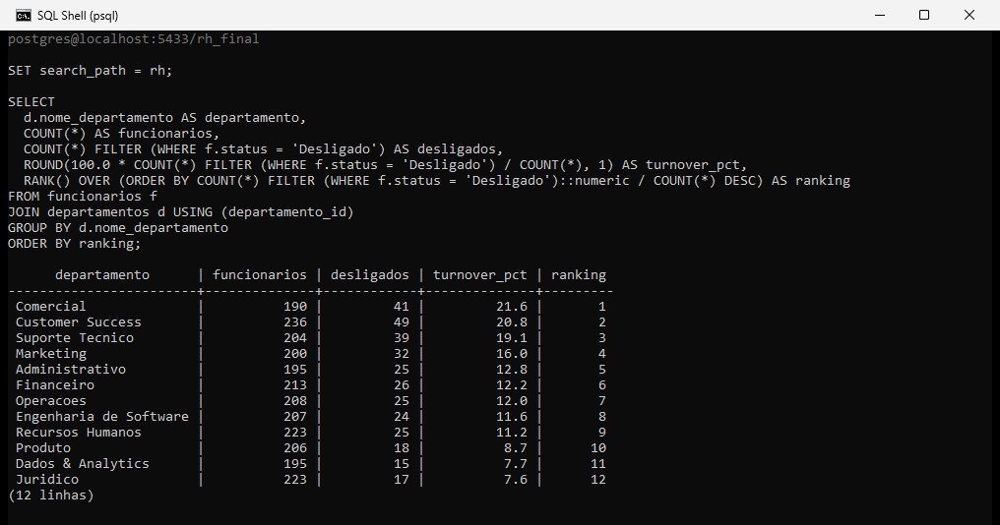

# Turnover e Desempenho — Panorama de RH 2024

Projeto de portfólio para transição de carreira para Análise de Dados. Setor: **people analytics / RH corporativo**. Ciclo completo: modelagem SQL, limpeza, análise e dashboard executivo em Power BI.

Documentação completa do projeto (conceitos, dataset, checklist e modelo do dashboard): [`documentos/DOCUMENTACAO_PROJETO.md`](documentos/DOCUMENTACAO_PROJETO.md).

---

## A base

Base sintética (mas calibrada com padrões reais de mercado de RH) de uma empresa fictícia de tecnologia em 2024: 2.500 funcionários que passaram pelo quadro entre 2018 e 2024, distribuídos em 12 departamentos e 4 diretorias, com histórico de admissão, salário, senioridade, modelo de trabalho e, quando aplicável, desligamento. As avaliações de desempenho (nota, engajamento e recomendação de promoção) são semestrais, mas existem só para 2024, nos ciclos 2024-S1 e 2024-S2. Não há avaliação de 2018 a 2023. Dos 336 desligados, 152 não têm nenhuma avaliação.

Os números a seguir vieram de execução real de SQL contra essa base, não são estimativa: 2.500 funcionários, 2.164 ativos e 336 desligados — turnover geral de 13,4%, tempo médio de casa de 3,4 anos e salário médio de R$ 8.535,32. Dos desligamentos, 70,8% foram voluntários, 24,4% involuntários e 4,8% aposentadoria. O turnover de 13,4% é o total de desligados de 2024 dividido pelos 2.500 que passaram pelo quadro (inclui quem foi admitido ao longo de 2024), não pelo headcount médio. Todos os desligamentos são de 2024, então a base não tem histórico de turnover de anos anteriores.

---

## Como o projeto foi montado

A base foi gerada em Python, com distribuições calibradas para reproduzir padrões reais de turnover: risco maior de saída em áreas comerciais e de atendimento (Comercial, Customer Success, Suporte Técnico), risco menor em áreas técnicas (Dados & Analytics, Jurídico), maior rotatividade no primeiro ano de casa, e queda de nota/engajamento associada a desligamento involuntário.

A modelagem, limpeza e análise rodaram em PostgreSQL, num schema próprio (`rh`). O pipeline usa CTE, window function (`RANK` para ranquear departamentos por turnover), `FILTER (WHERE ...)` para as contagens condicionais e `PERCENTILE_CONT` para medir a distribuição salarial por senioridade. Os blocos de análise estão em `02_sql/04_analises.sql`.

Turnover por departamento, ranqueado com `RANK()`:



O gerador `00_gerar_base.py` (seed 42) reproduz a base: rodei numa pasta temporária, com pandas 3.1.0 e numpy 2.5.4 (`requirements.txt`), e os hashes SHA-256 dos três CSVs saíram idênticos aos de `03_dados/`.

O dashboard final foi montado no Power BI, com modelo semântico próprio, medidas DAX e visuais nativos (cartão, barras e colunas).

---

## Estrutura do repositório

```
projeto-rh-turnover/
├── README.md
├── 00_gerar_base.py                        # geração da base sintética em Python
├── 02_sql/
│   ├── 01_criar_tabelas.sql                # DDL + índices + constraints
│   ├── 02_carga_dados.sql                  # COPY dos CSV
│   ├── 03_limpeza.sql                      # checagens + coluna derivada tempo_casa_anos
│   └── 04_analises.sql                     # análises com CTE/RANK/FILTER/PERCENTILE_CONT
├── 03_dados/
│   ├── departamentos.csv                   # 12 departamentos
│   ├── funcionarios.csv                    # 2.500 funcionários
│   └── avaliacoes_desempenho.csv           # 4.333 avaliações (ciclos 2024-S1 e 2024-S2)
├── 04_prints/                              # imagens reais do projeto
│   ├── capa_linkedin.png                   # capa com os KPIs principais
│   ├── print_dashboard_final.png           # dashboard Power BI completo
│   ├── print_sql_salario_senioridade.png   # print real do SQL — distribuição salarial (PERCENTILE_CONT)
│   └── print_sql_turnover_departamento.png # print real do SQL — turnover por departamento (RANK)
└── documentos/
    └── DOCUMENTACAO_PROJETO.md             # documentação completa do projeto (conceitos, dataset, checklist, modelo do dashboard)
```

---

## O que o dashboard mostra

O bloco de topo traz os cinco números que resumem o quadro: headcount total, turnover geral, percentual de desligamento involuntário, tempo médio de casa e salário médio. O ranking de turnover por departamento mostra Comercial (21,6%) e Customer Success (20,8%) na ponta mais alta, contra Jurídico (7,6%) e Dados & Analytics (7,7%) na ponta mais baixa — quase 3x de diferença entre o topo e a base do ranking. O cruzamento de desempenho com motivo de saída é o achado mais direto: quem foi desligado involuntariamente tinha nota média de 2,70 e engajamento de 43,0, bem abaixo dos ativos — mas quem pediu pra sair por conta própria tinha nota (3,69) e engajamento (71,4) praticamente idênticos aos de quem ficou (3,69 e 71,2), ou seja, na média agregada o desligamento voluntário não aparece como questão de desempenho. A distribuição salarial por senioridade mostra a mediana subindo de R$ 2.185,82 (Estagiário) até R$ 22.603,46 (Gerente), e o turnover por tempo de casa confirma o padrão clássico de risco: 22,5% no primeiro ano, caindo pra 11,0% em quem já tem mais de 4 anos de casa.

---

## Limites da comparação de notas

A nota de 3,69 é a média dos ativos (4.133 avaliações). A média de todas as avaliações da empresa é 3,68, então onde o texto compara com "o resto da empresa", leia ativos. A comparação com os involuntários vem de amostra pequena: são 50 avaliações de 45 pessoas, e 152 dos 336 desligados não têm avaliação nenhuma. As médias são por avaliação, não por funcionário.

A análise 2b de `02_sql/04_analises.sql` compara S1 com S2 pessoa a pessoa. Entre voluntários há só 11 pares, e a nota deles cai de 3,70 para 3,27, enquanto a dos ativos praticamente não muda (+0,01). Com 11 pares não dá para concluir nada, mas também não dá para dizer que voluntários e ativos se comportam igual ao longo do ano.

---

## Como reproduzir

Precisa de PostgreSQL 14+ com o `psql` no PATH. Os comandos abaixo rodam a partir da raiz do repositório e criam o banco antes de qualquer script:

```bash
export PGCLIENTENCODING=UTF8
psql -U postgres -c "CREATE DATABASE rh_turnover_db"
psql -U postgres -d rh_turnover_db -v ON_ERROR_STOP=1 -f 02_sql/01_criar_tabelas.sql
psql -U postgres -d rh_turnover_db -v ON_ERROR_STOP=1 -f 02_sql/02_carga_dados.sql
psql -U postgres -d rh_turnover_db -v ON_ERROR_STOP=1 -f 02_sql/03_limpeza.sql
psql -U postgres -d rh_turnover_db -v ON_ERROR_STOP=1 -f 02_sql/04_analises.sql
```

No PowerShell, troque a primeira linha por `$env:PGCLIENTENCODING = "UTF8"`. A ordem importa: 01 cria as tabelas no schema `rh`, 02 carrega os CSV, 03 faz a limpeza e cria `tempo_casa_anos`, 04 traz as análises. O turnover geral deve sair em 13,4%.

Os `\copy` do `02_carga_dados.sql` usam caminho relativo (`03_dados/...`), então o psql precisa ser iniciado da raiz do repositório. Rodando de outra pasta, a carga falha e deixa as tabelas vazias; sem `-v ON_ERROR_STOP=1` o psql só imprime o erro e segue para o próximo script, que roda sobre tabelas vazias, e o `04_analises.sql` aborta mais adiante com divisão por zero. No Windows, se precisar de caminho absoluto, use o estilo `C:/pasta/...`.

Os CSVs estão sem acento ("Juridico", "Operacoes", "Suporte Tecnico", "Hibrido", "Voluntario"), então é assim que os nomes aparecem nas consultas, embora o texto deste README e da documentação escreva com acento.

Para regenerar a base em vez de usar os CSVs prontos, rode `pip install -r requirements.txt` e `python 00_gerar_base.py` a partir da raiz. O script sobrescreve os arquivos de `03_dados/`.

---

## Autor

**Vitor França** — engcivil.vitorfranca@gmail.com
Em transição para Análise de Dados.
